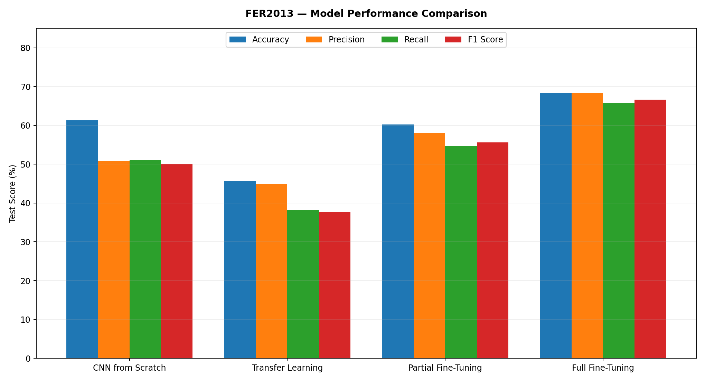
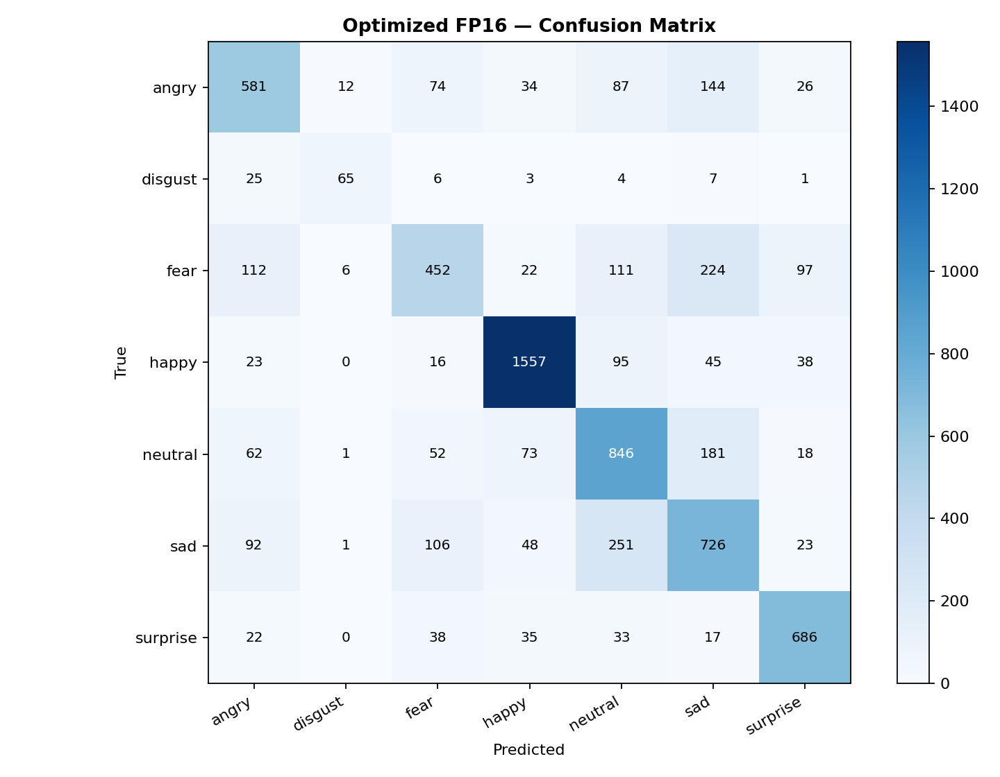
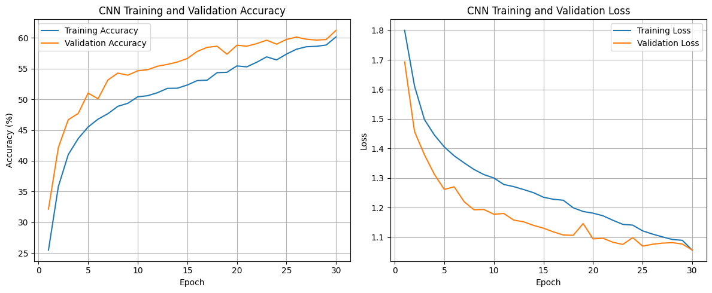
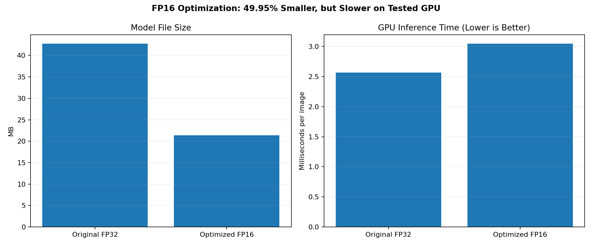
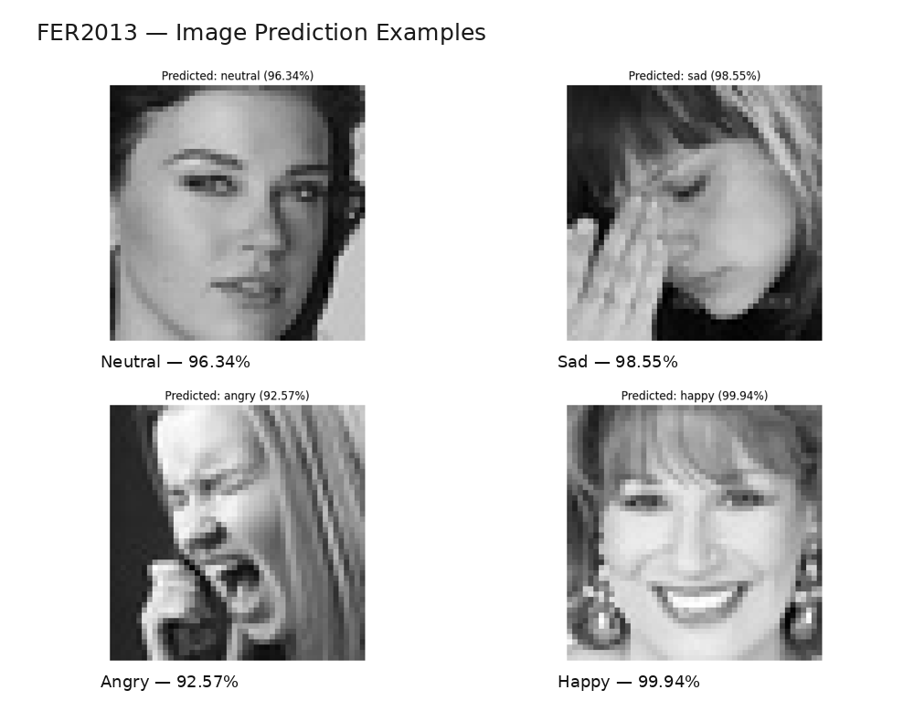

# Facial Expression Recognition Using Deep Learning

**CNN | Transfer Learning | Fine-Tuning | Model Optimization | Real-Time Detection**

**Developed by:** Noha Al-Shehri & Shahad Abu Shaheen

**Dataset:** FER2013  
**Framework:** PyTorch  
**Deployment:** Gradio

---

## 1. Project Overview

This project focuses on building a deep learning system capable of recognizing facial expressions from images and live webcam input.

The system classifies facial expressions into seven categories:

- Angry
- Disgust
- Fear
- Happy
- Neutral
- Sad
- Surprise

The project includes data preprocessing, CNN development, transfer learning, partial and full fine-tuning, model evaluation, optimization, and deployment.

Four approaches were compared to identify the best-performing model.

## 2. Problem Description

Facial expression recognition is a challenging computer vision task because different facial expressions can share similar visual features.

For example, Sad and Neutral expressions may be difficult to distinguish. Lighting, face orientation, and image quality can also affect predictions.

The objective of this project is to develop and evaluate deep learning models that can automatically classify facial expressions and demonstrate their predictions through an interactive application.

The system predicts visible facial expressions rather than a person's actual emotional state.

## 3. Dataset & Models Used

### Dataset: FER2013

The FER2013 dataset contains grayscale facial images representing seven facial expression categories.

**Dataset characteristics:**

- Original image size: 48 × 48 pixels
- Image format: Grayscale
- Number of classes: 7
- Training images: 22,967
- Validation images: 5,742
- Test images: 7,178

### Data Preprocessing

The dataset was prepared using:

- Training, validation, and testing splits
- Image normalization
- Tensor conversion
- Data augmentation for training
- Image resizing for ResNet18

For ResNet18, images were resized to **224 × 224 pixels** and converted to three channels to match the pretrained model's expected input.

### Models Implemented

**1. CNN from Scratch**

A custom Convolutional Neural Network was developed and trained from scratch using FER2013 images.

The CNN contains four convolutional blocks with seven convolutional layers, Batch Normalization, ReLU activation, Max Pooling, and Dropout.

**2. Transfer Learning (Feature Extraction)**

A pretrained ResNet18 model was used.

The feature extraction layers were frozen, and only the final classification layer was trained.

**3. Partial Fine-Tuning**

Selected final layers of ResNet18 were unfrozen.

The final residual block (`layer4`) and classification layer (`fc`) were trained while the earlier layers remained frozen.

**4. Full Fine-Tuning**

All ResNet18 layers were unfrozen and trained to adapt the pretrained model to facial expression recognition.

## 4. Workflow / Architecture

### Project Workflow

The project followed these stages:

1. **Dataset Loading:** Load FER2013 facial images and their labels.
2. **Data Preprocessing:** Prepare image transformations and training, validation, and testing datasets.
3. **CNN Development:** Build and train a CNN from scratch.
4. **Transfer Learning:** Train the ResNet18 classification layer using frozen pretrained features.
5. **Partial Fine-Tuning:** Train selected final layers of ResNet18.
6. **Full Fine-Tuning:** Train all layers of ResNet18.
7. **Model Evaluation:** Compare accuracy, precision, recall, F1 Score, and confusion matrices.
8. **Model Optimization:** Convert the best-performing model from FP32 to FP16.
9. **Deployment:** Build a Gradio interface for image uploads and live webcam predictions.


### CNN Architecture Visualization


CNN architecture showing the layers used for facial expression classification.

### Architecture Overview

**Custom CNN:**

Input Image → Convolutional Blocks → Feature Extraction → Flatten → Fully Connected Layers → 7 Expression Classes

**ResNet18:**

Input Image (224 × 224) → Pretrained ResNet18 Feature Extraction → Fully Connected Classification Layer → 7 Expression Classes

### Live Detection Workflow

Webcam / Uploaded Image → Face Detection → Image Preprocessing → Trained ResNet18 → Expression Prediction → Confidence Score

## 5. Results & Evaluation

### Model Performance Comparison

Four models were evaluated using the test dataset.

| Model | Accuracy | Precision | Recall | F1 Score |
|---|---:|---:|---:|---:|
| CNN from Scratch | 61.34% | 50.95% | 51.13% | 50.16% |
| Transfer Learning | 45.67% | 44.88% | 38.18% | 37.73% |
| Partial Fine-Tuning | 60.24% | 58.15% | 54.67% | 55.62% |
| **Full Fine-Tuning** | **68.45%** | **68.41%** | **65.78%** | **66.66%** |

Precision, Recall, and F1 Score are macro-averaged.

### Model Comparison Visualization

<p align="center">
  
</p>

### Best Performing Model

The **ResNet18 Full Fine-Tuning** model achieved the highest accuracy of **68.45%**.

This indicates that training all layers of the pretrained model was more effective than the other approaches evaluated in this project.

### Confusion Matrix

<p align="center">
  
</p>

The confusion matrix shows how the model classified each facial expression and highlights confusion between similar expressions.

### CNN Training and Validation Performance

<p align="center">
  
</p>

### Model Optimization

The best-performing ResNet18 model was optimized using FP16 precision to reduce its storage requirements.

| Metric | FP32 | FP16 |
|---|---:|---:|
| Model Size | 42.73 MB | 21.38 MB |
| Inference Time | 2.57 ms | 3.04 ms |
| Accuracy | 68.45% | 68.45% |
| Precision | 68.41% | 68.42% |
| Recall | 65.78% | 65.79% |
| F1 Score | 66.66% | 66.67% |

**Model Size Reduction: 49.95%**

FP16 reduced model size by approximately half while maintaining the same test accuracy. However, inference was slightly slower on the tested GPU.

<p align="center">
  
</p>

### Image Prediction Results

The trained model was tested on facial images.

| Predicted Expression | Confidence |
|---|---:|
| Neutral | 96.34% |
| Sad | 98.55% |
| Angry | 92.57% |
| Happy | 99.94% |

<p align="center">
  
</p>

### Real-Time Webcam Detection

An interactive Gradio application was implemented to perform facial expression recognition using live webcam input.

The application uses the trained ResNet18 model to detect faces, classify facial expressions, and display prediction confidence.

<p align="center">
  
</p>

**Example:** Happy expression detected with 99.1% prediction confidence.

This confidence score refers to an individual prediction and does not represent overall model accuracy.

## 6. Technologies Used

| Technology | Purpose |
|---|---|
| Python | Programming language |
| PyTorch | Deep learning model development |
| Torchvision | Pretrained models and image transformations |
| ResNet18 | Transfer learning and fine-tuning |
| NumPy | Numerical operations |
| Pandas | Data handling |
| OpenCV | Image processing and face detection |
| Pillow | Image processing |
| Scikit-learn | Model evaluation |
| Matplotlib | Data visualization |
| Seaborn | Confusion matrix visualization |
| Gradio | Interactive deployment |
| Google Colab | Development and model training |
| GitHub | Project documentation and version control |

## 7. How to Run the Project

### Requirements

- Python environment
- Google Colab (recommended)
- FER2013 dataset
- Required Python libraries
- Webcam access for live detection (optional)

### Step 1: Clone the Repository

```bash
git clone https://github.com/nfsh46655-jpg/Facial-Emotion-Recognition-FER2013.git
```

### Step 2: Open the Notebook

Open the project notebook in Google Colab.

If using the provided notebook file, open:

`FER2013_Project_Corrected.ipynb`

### Step 3: Install Dependencies

Install the required Python libraries if they are not already available:

```bash
pip install torch torchvision numpy pandas opencv-python pillow scikit-learn matplotlib seaborn gradio
```

### Step 4: Prepare the Dataset

Download and extract the FER2013 dataset.

Update the dataset paths in the notebook to match the location of the training and testing images.

### Step 5: Run the Notebook

Execute the notebook cells in order to:

1. Load and preprocess the dataset.
2. Train the CNN model.
3. Apply transfer learning.
4. Perform partial and full fine-tuning.
5. Evaluate and compare the models.
6. Optimize the best-performing model.

A GPU runtime is recommended for training.

### Step 6: Run the Gradio Application

Execute the deployment section of the notebook after loading the trained model.

The Gradio interface allows users to:

- Upload facial images
- Use live webcam input
- View predicted facial expressions
- View model confidence scores

Allow webcam permissions when prompted.

**Note:** Dataset paths and trained model files must be available in the runtime. The Gradio interface is launched from the deployment code in the notebook.

## 8. Future Improvements

Future improvements could include:

- Applying more advanced data augmentation.
- Testing additional pretrained architectures.
- Improving classification of difficult expressions such as Fear.
- Reducing overfitting through regularization and hyperparameter tuning.
- Improving real-time face detection under different lighting conditions.
- Evaluating the system on additional real-world datasets.
- Exploring further deployment optimization.

## 9. SDAIA Academy GitHub Repository Link

**SDAIA Academy — Official GitHub:**

https://github.com/SDAIAAcademy

**Project GitHub Repository:**

https://github.com/nfsh46655-jpg/Facial-Emotion-Recognition-FER2013

---

## Project Conclusion

This project demonstrates a complete deep learning workflow for facial expression recognition.

Four model training approaches were implemented and compared.

ResNet18 with Full Fine-Tuning achieved the highest test accuracy of **68.45%**.

FP16 optimization reduced the model size by approximately **50%** without reducing its test accuracy.

Finally, the model was deployed using Gradio to support facial expression predictions from uploaded images and live webcam input.

---

## Project Contributors

**Noha Al-Shehri**  
**Shahad Abu Shaheen**

### Acknowledgment

**Saudi Data & Artificial Intelligence Authority (SDAIA)**

**SDAIA Academy**

Official website: https://sdaia.gov.sa/

---

**Facial Expression Recognition | Deep Learning | Computer Vision | PyTorch | ResNet18 | Gradio**
